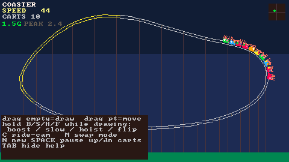
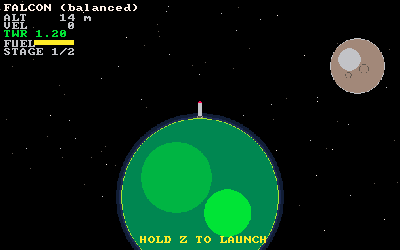
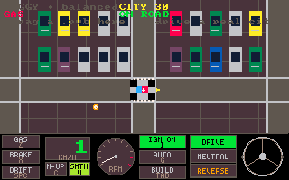
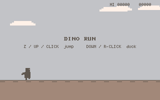

# dreamengine

A tiny fantasy console. Write a game as one C file, press run, get a native window.
Then ship it as a Mac app, a Windows exe, or a web page anyone can play.

<p>
  
  
  
  
</p>

**Play some in your browser:** <https://nikkikoole.github.io/dreamengine/>

Inspired by PICO-8, DIV Game Studio and BlitzMax: a small fixed screen (320×200 by default),
a 32-colour palette, sprites, a tilemap, a real synth for sound and music, and an editor that
keeps it all in one place. The language is plain C with short PICO-8-style names, so a whole
game fits in your head.

```c
#include "studio.h"

float x = 160, y = 100, vx = 2.3f, vy = 1.7f;

void update() {                       // 60 times a second
    x += vx; y += vy;
    if (x < 8 || x > SCREEN_W - 8) vx = -vx;
    if (y < 8 || y > SCREEN_H - 8) vy = -vy;
}

void draw() {
    cls(CLR_DARK_BLUE);
    circfill((int)x, (int)y, 8, CLR_YELLOW);
    print("hello, dreamengine", 4, 4, CLR_WHITE);
}
```

## Getting started (macOS)

You need [Homebrew](https://brew.sh), Xcode's command line tools (`xcode-select --install`)
and Node 22 (via [nvm](https://github.com/nvm-sh/nvm)).

```bash
brew install raylib
git clone --depth 1 https://github.com/NikkiKoole/dreamengine-studio.git
cd dreamengine-studio
make install    # editor dependencies
make            # opens the editor
```

Pick a cart from the tutorials panel and press **▶ run**. The numbered ones (`01-hello`,
`02-shapes`, `03-move` …) are a walk from a blank screen to a whole game.

`--depth 1` fetches only the latest state, not the full history. That's much faster, and
plenty for making games.

Windows and Linux are not supported as a development machine yet, but you can export a
Windows `.exe` from the Mac.

## Making a game

A cart is `tools/carts/<name>.c` (plus an optional `<name>.cart.js` for sprites and maps drawn
in code). Start from a cart that's close to what you want:

| you want to make | look at |
|---|---|
| arcade games | `dinorun`, `juice`, `18-invaders`, `19-breakout`, anything tagged `arcade` |
| point-and-click | `adventure`, `zak` |
| something musical | `rootwalk`, `groovebook` |

Guides worth reading first:

- [cart authoring](docs/guides/cart-authoring.md): how a cart is put together, sprites, metadata
- [game feel](docs/guides/game-feel.md): making every action feel like it landed
- [debug harness](docs/guides/debug-harness.md): run a cart headless, record input, dump frames
- the full API: the **help** tab in the editor, or `node tools/api.js <name>` (e.g. `circfill`)

## Getting it out there

One cart, several ways out ([exporting guide](docs/guides/exporting.md)):

- **The web (wasm):** `brew install emscripten`, then **build for web** in the editor for a
  local preview (your phone on the same wifi can open it too), or
  `node tools/build-site.js <name>` for a folder you can host on any static site
  (GitHub Pages, itch.io).
- **A Mac app:** signed and notarized if you have an Apple developer account, plain otherwise.
- **Windows:** an unsigned `.exe`, cross-compiled with mingw-w64 and raylib's win64 build
  (setup in the exporting guide).
- **iPhone:** a test build on a plugged-in device (needs your own Apple developer setup).

## Working with Claude

This repo is built together with [Claude Code](https://claude.com/claude-code), and it shows:
`CLAUDE.md` and `docs/` are written so an agent can find its way around. Be aware they're tuned
to the maker's own setup (several agents committing straight to one branch, App Store tooling,
a deep music engine). If you're contributing, work in a fork on a branch and send pull requests;
the "never branch" rule in `CLAUDE.md` is for the maker's own agents only.

## Contributing

Very welcome, especially from people making their first game here:

- **Something missing or broken** (a setup step, a doc, an API, an example): a small, focused
  pull request.
- **Something bigger, or a "this should work differently"**: open an issue first, with what you
  tried and what happened.
- **Your own carts** are welcome as pull requests too.

## Where things are

```
runtime/   the engine: studio.h (the API), studio.c, sound, and helper headers (ui.h, physics.h …)
editor/    the Electron editor: code, sprites, maps, run/export buttons
tools/     command-line tools; tools/carts/ holds every cart's source
docs/      guides, design notes, decisions. Start at docs/README.md
```
